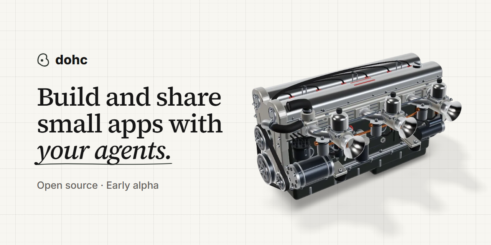

<a href="https://dohc.computer">
  <picture>
    <source media="(prefers-color-scheme: dark)" srcset="social-assets/dohc-readme-banner-dark.png">
    
  </picture>
</a>

<p align="center">
  <a href="https://dohc.computer/#downloads"></a>
  <a href="#where-it-is-today"></a>
  <a href="LICENSE"></a>
</p>

<p align="center">
  <a href="https://dohc.computer">Website</a> |
  <a href="https://dohc.computer/#downloads">Download</a> |
  <a href="docs/README.md">Docs</a> |
  <a href="docs/how-to/self-host.md">Self-host</a> |
  <a href="CONTRIBUTING.md">Contributing</a>
</p>

dohc is a free, open-source desktop app for building and sharing small apps with your agents. It's a local-first workspace for your files, documents, data, chat, and apps, with sync, sharing, permissions, and history built in.

When an agent builds you a tool, dohc gives it a place for its data, a share link with the access you choose, and a chat where people and their agents keep working on it.

[Download the newest nightly build](https://dohc.computer/#downloads) or [run it from source](#run-it-from-source).

## Why this exists

Agents can build a small app really quickly. Then every app needs the same few things. It needs a place for its data, an interface people already know, a safe way for other people to use it, a way to work on it together, and a record of what each agent made.

Developers can wire that up with git, MCP servers, Tailscale, Supabase, and Cloudflare. It's tedious, so most of these apps stay on one laptop, and most people don't build them at all. dohc puts that setup in one app.

Agents now write much of the software people run, and few people read it. The more an agent builds for you, the more you depend on the layer underneath. dohc owns that layer. Sync, history, permissions, and app isolation work the same whether a person or an agent made the change, so you can let an agent build an app without reading its code to know what data it can reach.

Our bet is that keeping the app's source, data, and discussion together makes the work easier to use, change, and hand over. A workspace should be useful alone and let another person or agent continue the same work when you share it.

## Agents and workspace apps

dohc is agent agnostic. It does not provide an agent or prescribe how agents should work. A human, agent, or script can change the same workspace through the access each user configures.

Workspace apps are web apps whose source lives in the workspace. Collaborators can inspect and edit the source with their own tools and agents. Apps receive only the workspace data and capabilities their owner exposes.

Published apps can be opened through a share link by people who do not use dohc, subject to the owner's access settings. Publishing from the packaged desktop requires Windows x64, an Apple silicon Mac running macOS 13.5 or later, or Linux x64 with Linux 5.13 or later and Landlock enabled. It also requires a self-hosted server with app publishing enabled. It is disabled in the default server bundle; see the [self-hosting guide](docs/how-to/self-host.md).

Apps can use approved Collection data through the operations their owner grants. Creating local Collection-backed apps requires Windows x64, an Apple silicon Mac running macOS 13.5 or later, or Linux x64 with Linux 5.13 or later and Landlock enabled. See the [app backend guide](docs/how-to/app-backend.md) for data, sharing, and current limits, and the [desktop capability requirements](docs/reference/desktop-capabilities.md) for platform and service limits.

## Where it is today

dohc is an early alpha, released as nightly builds. Download the newest one from Releases. When an update is available, select Update at the top right of dohc to download it, then select Restart to update. On Windows and macOS, a downloaded update also installs when you quit dohc. On Linux, approve the installation when the system asks. We are still proving these workflow benefits with users. Expect missing pieces, rough edges, and breaking changes. Read the known issues pinned at the top of the issue list before you start. Saving a note can rewrite Markdown that dohc doesn't keep yet, so try dohc on a copy of a notes folder.

The desktop app currently includes:

- Workspace apps whose source lives in the workspace, with Collection data, forms, and share links.
- Collections with table, board, and calendar views.
- A rich Markdown editor with wikilinks, backlinks, and a graph view.
- Drawings and diagrams that sit in the same folder as your docs.
- Workspace chat that people and outside agents can use.
- Version history with diffs and restore.
- Search across workspace files and chats.
- A `dohc` CLI and an MCP server, so any agent can work in a workspace.
- Local workspaces that open ordinary folders on your computer.
- Local web project previews.
- Optional self-hosted sync, sharing, presence, and live co-editing.

Local work does not require an account or server. Sync and sharing use a server you operate.

**dohc Drive is coming soon.** It will be the managed service, with a planned free tier. It will also host the apps you publish. dohc will handle hosting, setup, and maintenance. Self-hosting provides the same collaboration capabilities; you operate the services and choose who can reach them.

Follow the [self-hosting guide](docs/how-to/self-host.md) to set up a server and connect the desktop app.

## Run it from source

You need Node.js 24.16 or newer, pnpm 11.20.0, and the Rust toolchain pinned in [`rust-toolchain.toml`](rust-toolchain.toml).

```bash
pnpm install
pnpm dev
```

The development command builds the Rust workspace engine before Electron starts. The desktop app runs without an account, server, or environment file.

Run the marketing site separately:

```bash
pnpm dev:site
```

## Develop the collaboration services

Multi-device sync, sharing, presence, and live co-editing use optional services:

- `services/workspace-api` provides authentication.
- `services/sync-relay` carries engine operations, files, shares, and presence.
- `services/share-web` serves browser share links.

Postgres stores authentication data. The relay stores its own data in SQLite. Start Postgres and apply the migrations:

```bash
pnpm dev:postgres
pnpm migrate
```

In both service terminals, set `NODE_ENV=development` and the same `BETTER_AUTH_SECRET`, at least 32 characters. Then start each service:

```bash
pnpm dev:workspace-api
pnpm --filter @dohc/sync-relay dev
```

In a third terminal, [configure share-web](services/share-web/README.md), build its viewer assets, and start it:

```bash
pnpm --filter @dohc/share-web build
pnpm --filter @dohc/share-web dev
```

These commands run development services. Use the [self-hosting guide](docs/how-to/self-host.md) for a production deployment.

## Repository map

```text
apps/desktop          Electron desktop app
apps/mobile           phone app in React Native with Expo, on demo data until its server work lands
apps/site             marketing site and interactive product demo
crates                Rust workspace engine and supporting crates
docs                  user guides and reference; engineering guidance in docs/engineering
fixtures              workspace fixtures the engine crates read
packages              shared TypeScript contracts, clients, tools, and UI code
services              optional authentication, sync, and share viewer services
tools/rust-engine-program   the Rust gate and its fixture goldens
tools/perf-profiling  renderer and engine profiling harnesses
```

## Checks

Run the smallest check that covers your change. Common checks are:

```bash
pnpm typecheck
pnpm test:desktop
pnpm test
```

Run Rust checks through [`rust-gate`](.agents/skills/rust-gate/SKILL.md), never a bare `cargo` command. Contributors and agents should read [`AGENTS.md`](AGENTS.md) before changing the codebase, and [`CONTEXT.md`](CONTEXT.md) for the vocabulary.

## Contributing

See [CONTRIBUTING.md](CONTRIBUTING.md) for accepted changes, checks, and the contributor agreement. Report vulnerabilities through [SECURITY.md](SECURITY.md).

## Stack

Electron, React, Vite, Tailwind CSS, Tiptap, Yjs, Rust, SQLite, Better Auth, Postgres, Vitest, and Playwright.

## License

dohc uses [AGPL-3.0-only](LICENSE) by default, including the desktop app, Rust engine, services, and brand package. You may self-host under its terms. Distribution requires the applicable source and notices; modified versions offered over a network must offer corresponding source to their users.

Shared libraries with their own MIT `LICENSE` files and [generated TypeScript protocol types](crates/dohc-engine-protocol/generated/ts/LICENSE) use MIT. These can be reused in proprietary software with the required notices. Their licenses do not relicense AGPL code they use. Third-party code retains its own licenses.

Your files, documents, data, and independently authored apps keep their own licenses. Using dohc does not itself make your work AGPL. Copying or combining AGPL code may carry obligations under that license.

The code licenses do not grant permission to imply official endorsement of a fork or hosted service.
